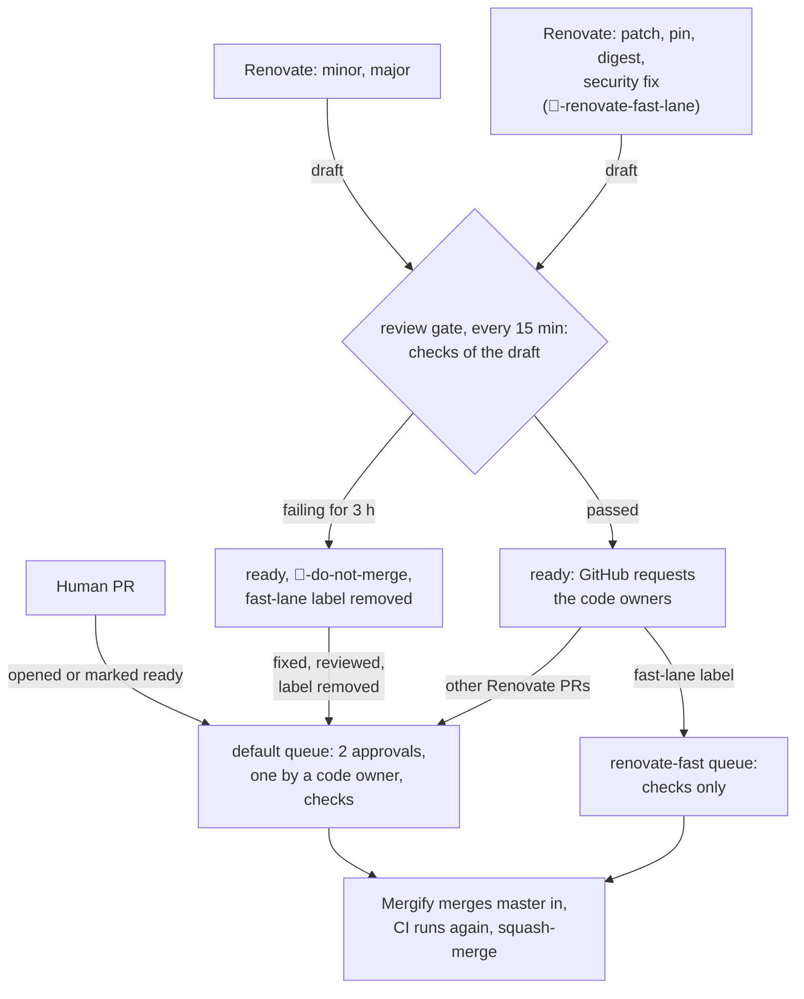
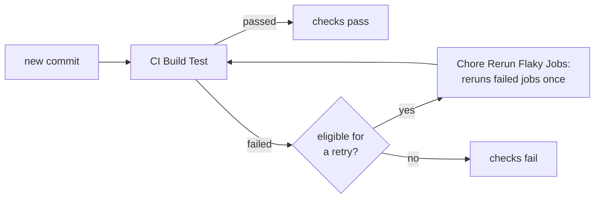

# Dependency updates (Renovate)

A self-hosted Renovate updates the dependencies in this repository: Python
lockfiles, Docker images, GitHub Actions, `uv`, and the Python patch version.
Neither the Mend-hosted app nor Dependabot opens them. Dependabot alerts stay on
as a vulnerability source only.

| What | Where |
| --- | --- |
| Runner and review gate (one job each) | [.github/workflows/chore-renovate.yml](../.github/workflows/chore-renovate.yml) |
| Repository configuration | [.renovaterc.jsonc](../.renovaterc.jsonc) |
| Admin configuration (`allowedCommands`, `platformCommit`) | [.github/renovate/global-config.json5](../.github/renovate/global-config.json5) |
| Lockfile re-resolution post-upgrade task | [.github/renovate/resync_lockfiles.py](../.github/renovate/resync_lockfiles.py) |
| Review gate script (drafts go ready) | [.github/renovate/review_gate.sh](../.github/renovate/review_gate.sh) |
| Who reviews them | [CODEOWNERS](../.github/CODEOWNERS), last block |
| Who merges them | [mergify.yml](../.github/mergify.yml) |

Renovate runs as the GitHub App `osparc-simcore-renovate[bot]`. That App signs
its commits and runs `make reqs` as a post-upgrade task, which the hosted
Renovate cannot do. Do not push a fixup commit under another author. CI waits
for approval before running a commit it did not sign, and Renovate stops
touching a branch that someone else wrote last. Mergify's merge commits are the
exception (`gitIgnoredAuthors`, see below).

The `renovate` job runs:

- nightly at 02:17 UTC;
- on a push to `master` that changes a file Renovate manages (the paths of the
  last CODEOWNERS block) or its configuration, so the other open Renovate pull
  requests are rebased right after a merge;
- when a person edits the Dependency Dashboard or ticks the rebase box of a
  Renovate pull request;
- on demand (*Run workflow*, job `renovate`).

The `review-gate` job runs every 15 minutes and does not run Renovate. New
Renovate pull requests get the current milestone from
[chore-labeler.yml](../.github/workflows/chore-labeler.yml), like every other
pull request.

## Update policies

- **Security fixes skip the throttling.** `osvVulnerabilityAlerts` and the
  Dependabot alerts open the pull request on the next run. It needs no
  Dependency Dashboard approval and waits for no cool-down. It gets the
  `security` label and `🤖-renovate-fast-lane`, so a security fix whose checks pass
  merges through the fast lane (see below) whatever the version jump.
  `vulnerabilityFixStrategy: "highest"` makes it propose the
  newest release, not the lowest one that fixes the vulnerability. A branch then
  cannot offer two versions of the same package.
- **Regular updates are throttled.** Two new pull requests per run, two open at
  a time. The Dependency Dashboard holds the rest. It is also where you tick
  Docker image majors and the monthly `lockFileMaintenance` runs; majors of
  Python packages, GitHub Actions and `uv` arrive as regular pull requests.
- **Cool-downs.** 14 days for every dependency: pip-compile lockfiles, GitHub
  Actions, and `uv`. Security fixes skip them.
- **One PR per dependency.** A pip-compile package gets a single PR that moves
  its pin in every `requirements/` directory at once (the resync post-upgrade
  task propagates it). No PRs grouped per directory or per area. The
  `opentelemetry-*` packages are the exception: they ship in two coordinated
  release trains that pin each other, so one PR moves the whole family
  (`renovate/opentelemetry`, majors on their own branch). Security pull
  requests are never grouped: Renovate's `vulnerabilityAlerts` default resets
  the group name, so a vulnerable package gets its own immediate PR.

## From pull request to merge

How each kind of pull request reaches `master`:

Every commit runs CI Build Test. Chore Rerun Flaky Jobs retries the failed jobs
of a run once, when it is the first attempt on a pull request from a fork, a
Renovate pull request (drafts included) or `master`, 1 to 3 jobs failed, and
none of them is linting or a typecheck. A human pull request from this
repository is retried by hand:

Renovate never merges. `automerge` stays `false`. Mergify merges its pull
requests, either reviewed or through a fast lane, and reviewers are requested
only after the checks have finished:

1. Renovate opens every pull request as a draft (`draftPR`), so GitHub does not
   auto-request the code owners up front — security pull requests included.
2. The `review-gate` job polls the drafts every 15 minutes. Once all
   checks of the head commit are done, it marks the pull request ready — and the
   ready transition makes GitHub request the code owners itself:
   - **all passed, `🤖-renovate-fast-lane` label** (patch, pin and digest bumps,
     and every security fix): the `renovate-fast` Mergify queue merges it without
     waiting for that review — the request goes out, nothing blocks on it. GitHub
     does not let anyone withdraw a code-owner request, so it stays until the merge;
   - **all passed, no label** (minors, majors, everything else): the requested
     code-owner review is what the pull request then waits for;
   - **failing**: nothing for 3 h so Renovate can push its own fix. If the last
     commit is still failing, the pull request gets `🤖-do-not-merge`, loses
     `🤖-renovate-fast-lane`, is marked ready (which requests the code owners),
     and a warning comment lists the failing checks. From then on it goes
     through the reviewed path, also once a fix makes its checks pass.

   The gate leaves a draft alone once it has requested reviewers or reviews, so
   a pull request turned back into a draft stays a draft.
3. The reviewed path merges once Mergify's conditions match: the branch is
   up to date with `master` (the ruleset marks the checks *strict*), reviewers
   approve twice, request no changes, leave no thread open, and a code owner
   approves. For the files Renovate writes, the owners are the four people in
   the last block of `.github/CODEOWNERS`. They own *only* version manifests:
   `**/requirements/**`, Dockerfiles, `docker-compose*.yml`, `.python-version`,
   and the Actions pinned under `.github/workflows/**`. One dependency bump
   rewrites dozens of directories at once, so leaving those files to the
   per-service rules would make every security fix wait on six or seven
   reviewers.

Add the `🤖-do-not-merge` label to hold a pull request back, from either lane.
Remove it to let the pull request go; a fast-lane pull request then merges
without waiting for a review. On the reviewed path, anyone else may
still approve, and their review counts toward the two approvals, but it does not
clear the code-owner gate.

How the fast lane gets past the review requirement:

- Mergify copies the rules of the `master` rulesets into the conditions of every
  queue, including the *master-branch-reviews* rule (two approvals, a code
  owner, threads resolved). Being on that ruleset's bypass list only changes what
  GitHub lets Mergify do, not what Mergify waits for. The `renovate-fast` queue
  therefore sets `branch_protection_injection_mode: none`;
- `none` also drops the required checks of the *master branch* ruleset. Instead
  of a copy of the ruleset's list, the queue requires that no check of another
  app than Mergify is pending or failed (`-check-pending~=^@(?!mergify/)`,
  same for `check-failure`) and that `system-tests` passed. Any failing check
  therefore keeps a pull request out of the fast lane. The `system-tests`
  condition keeps the pull request waiting until CI has reported on the commit
  Mergify adds; renaming that job stalls the fast lane;
- GitHub enforces a ruleset's requirements on the actor that performs the
  merge. The *master-branch-reviews* ruleset has the Mergify App on its bypass
  list in *exempt* mode and Maintain in *pull request* mode, so GitHub lets
  Mergify merge without the reviews. The *master branch* ruleset (required
  checks, push protections) has no Mergify entry, so GitHub itself still
  refuses Mergify a merge with a failing required check. Human pull requests
  lose nothing: the default queue keeps the injected conditions;
- the fast lane only takes a pull request Renovate wrote alone: Renovate opened
  it, and every commit is authored by Renovate or Mergify and verified by
  GitHub (`renovate_only` in `mergify.yml`). A commit pushed by anyone else
  sends the pull request to the default queue, which waits for reviews; so
  does the label on a human pull request;
- Renovate applies the `🤖-renovate-fast-lane` label. It replaces
  `🤖-automerge`, which no Mergify rule reads anymore.

To fix a failing Renovate pull request, do not push to its branch. Fix the
cause on `master` in a pull request of your own (code that breaks with the new
version, a constraint, the Renovate configuration) and let Renovate regenerate
its branch on top of it, or close it and open your own pull request with the
update and the fix.

When the resync task cannot propagate a pin to every directory that constrains
it, it leaves `renovate-resync-report.md` in the pull request and Renovate
reports a failing `renovate/artifacts` check. A patch-level resync failure
therefore keeps the pull request out of the fast lane: marking it ready after
the 3 h cool-down requests the code owners.

## Keeping a pull request up to date

GitHub's *Update branch* button is disabled. Two tools update a Renovate branch:

- **Renovate** rebuilds every branch that is behind `master` or conflicts with
  it on each run (`rebaseWhen` resolves to `behind-base-branch` because the
  ruleset requires up-to-date branches). It redoes the update and the resync task
  on top of `master`, so overlapping pins are regenerated, not merged as text.
  It skips a branch that has a commit by anyone other than itself or Mergify;
  tick the rebase box of the pull request to have it start over;
- **Mergify** tests one pull request at a time on its own branch. When the queue
  conditions match, it merges `master` into the branch, waits for the checks of
  that commit, and squash-merges. That is a plain git merge: two pull requests
  that move the same pins without a textual conflict are not regenerated, and no
  check re-runs pip-compile, so CI only catches pins that fail to install.

A pull request that waits for reviews is only updated by Renovate's runs. The
push trigger of the `renovate` job makes that happen within minutes of every
dependency merge.

## Adding something new for Renovate to manage

Add it to the last block of `.github/CODEOWNERS` too, whether it is a new
lockfile directory or a new file that holds a version pin. Otherwise GitHub asks
the owners of every service the pull request touches, or nobody at all, and the
pull request stalls.
